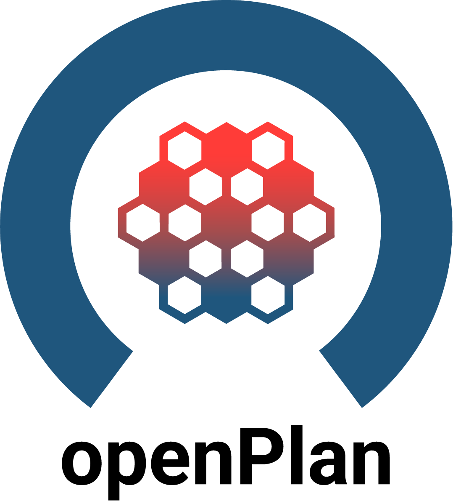
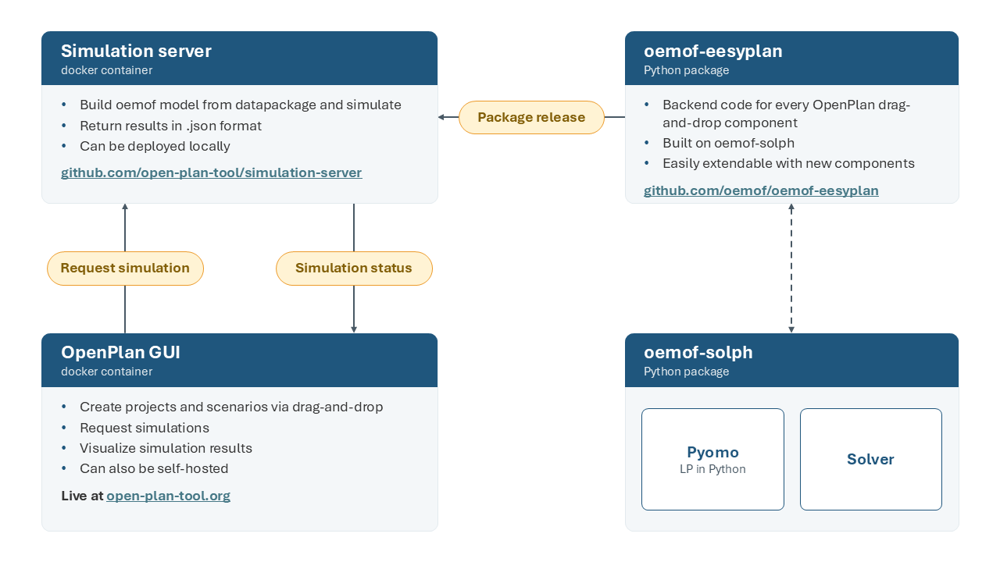

# Welcome to the OpenPlan GUI repository
<p align="center">

</p>

Learn more about the OpenPlan project on our [website](https://open-plan-tool.org/).

## Credits
This code builds on a user interface for the [multi-vector-simulator](https://github.com/rl-institut/multi-vector-simulator) (MVS), developed in the [Horizon2020](https://elandh2020.eu/) ELAND project. Within OpenPlan, it was redesigned and extended based on feedback from stakeholder workshops.

## Basic structure
This repository contains the OpenPlan GUI. Simulations run on a separate [simulation server](https://github.com/open-plan-tool/simulation-server), which builds the energy system models with [oemof-eesyplan](https://github.com/oemof/oemof-eesyplan). Every drag-and-drop component in the GUI has a matching class in oemof-eesyplan, which details how the component is modelled and behaves within the simulation.


Earlier versions used the MVS as simulation backend; it is now considered legacy.


# Getting Started

## Deploy locally using and using our open plan MVS server

Prior to be able to develop locally, you might need to install postgres, simply google `install postgres` followed by your os name (`linux/mac/windows`)

1. Create a virtual environment using `python=3.12`
2. Activate your virtual environment
3. Move to the `app` folder with `cd app`
4. Install local development dependencies with `pip install -r requirements/local.txt`
5. Create a `.env` file (inside `app`) and define the following environment variables (only replace content surrounded by `<>`).
```
EPA_SECRET_KEY=<randomly generated string>
SQL_DATABASE=<your db name>
SQL_USER=<your user name>
SQL_PASSWORD=<your password>
SQL_HOST=localhost
SQL_PORT=5432
TRUSTED_HOST=http://127.0.0.1:8000
DEBUG=(True|False)
MVS_API_HOST=<the simulation server you wish to use>
```
6. Set up pre-commit hooks with `pre-commit install`
7. Execute the `local_setup.sh` file (`. local_setup.sh` on linux/mac `bash local_setup.sh` on windows) you might have to make it executable first. Answer yes to the question
8. Start the local server with `python manage.py runserver`
9. You can then login with `testUser` and `ASas12,.` or create your own account

## Deploy using Docker Compose
The following commands should get everything up and running, using the web based version of the MVS API.

You need to be able to run docker-compose inside your terminal. If you can't you should install [Docker desktop](https://www.docker.com/products/docker-desktop/) first.

* Clone the repository locally `git clone --single-branch --branch main https://github.com/open-plan-tool/gui.git open_plan_gui`
* Move inside the created folder (`cd open_plan_gui`)
* Edit the `.envs/epa.postgres` and `.envs/db.postgres` environment files
   * Change the value assigned to `EPA_SECRET_KEY` with a [randomly generated one](https://randomkeygen.com/)
   * Make sure to replace dummy names with you preferred names
   * The value assigned to the variables `POSTGRES_DB`, `POSTGRES_USER`, `POSTGRES_PASSWORD` in `.envs/db.postgres` should match the ones of
   the variables `SQL_DATABASE`, `SQL_USER`, `SQL_PASSWORD` in `.envs/epa.postgres`, respectively

   * Define an environment variable `MVS_API_HOST` in `.envs/epa.postgres` and set the url of the simulation server
   you wish to use for your models (for example `MVS_API_HOST="<url to your favorite simulation server>"`), you can deploy your own [simulation server](https://github.com/open-plan-tool/simulation-server) locally if you need

    * Assign the domain of your website (including `http://` or `https://`) to `TRUSTED_HOST` , see https://docs.djangoproject.com/en/4.2/ref/settings/#csrf-trusted-origins for more information

Next you can either provide the following commands inside a terminal (with ubuntu you might have to prepend `sudo`)
* `docker-compose --file=docker-compose-local.yml up -d --build`
* `docker-compose --file=docker-compose-local.yml exec -u root app_pg sh initial_setup.sh` (this will also load a default testUser account with sample scenario).


Or you can run a python script with the following command
* `python deploy.py`

Finally
* Open browser and navigate to http://localhost:8000: you should see the login page of the open_plan app
* You can then login with `testUser` and `ASas12,.` or create your own account

### Proxy settings (optional)
If you use a proxy you will need to set `USE_PROXY=True` and edit `PROXY_ADDRESS=http://proxy_address:port` with your proxy settings in `.envs/epa.postgres`.

<hr>
>**_NOTE:_** Grab a cup of coffee or tea for this...
<hr>

## Test Account
> You can access a preconfigured project using the following login credentials:  `testUser:ASas12,.`
<hr>

## Tear down (uninstall) docker containers
To remove the application (including relevant images, volumes etc.), one can use the following commands in terminal:

`docker-compose down --file=docker-compose-local.yml -v`

you can add `--rmi local` if you wish to also remove the images (this will take you a long time to rebuild the docker containers from scratch if you want to redeploy the app later then)

Or you can run a python script with the following command

`python deploy.py --down`
